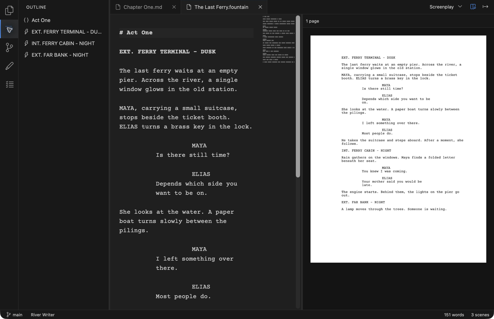
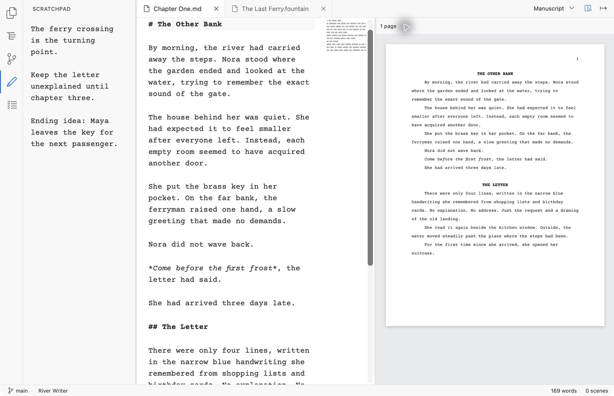
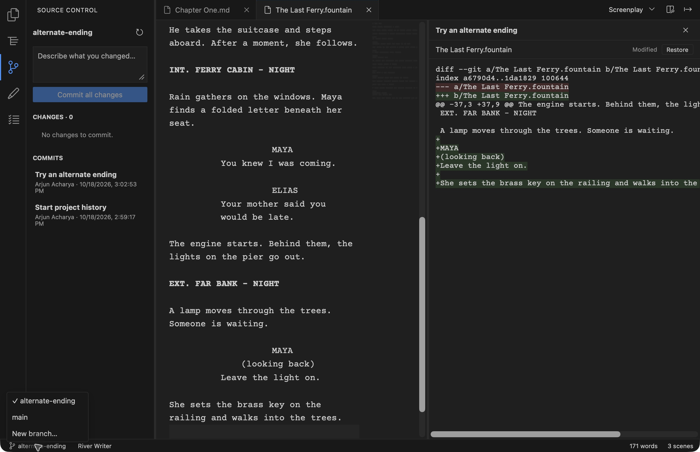

# River Writer

A quiet Mac app for screenplays, stage plays and novels. You write plain text, and River
shows the formatted pages beside it.



## What it does

* **Plain-text files you own.** Screenplays and stage plays are `.fountain`, novels are
  `.md`. A project is just a folder, so your writing opens in any other editor too.
* **The page beside the words.** A live preview shows how each page will print, using
  Screenplay, Multi-cam, Stage Play or Manuscript formatting. Export to PDF.
* **A writing surface that knows the form.** Scene headings, character names and dialogue
  sit where they belong as you type, with suggestions for characters and locations.
* **Outline, Scratchpad and Todos** in the sidebar, kept as plain files in the project.
* **Versions with Git, built in.** Commit a draft, browse earlier ones, restore a file, and
  try an alternate ending on a branch. Nothing else to install.
* **Autosave and crash recovery.** Work is saved a second after you stop typing.





## What it doesn't do

No accounts, cloud sync, subscriptions, telemetry or AI features. River makes no network
connections. It runs on macOS 13 or later; there is no Windows or Linux version.

## Install (build it yourself)

River is distributed as source. Building takes a few minutes the first time and needs
these free tools:

1. Xcode Command Line Tools: `xcode-select --install`
2. Rust 1.96 or newer: install from [rustup.rs](https://rustup.rs)
3. Node.js 22.12 or newer: from [nodejs.org](https://nodejs.org) or Homebrew
4. pnpm 9: `corepack enable` (comes with Node)

Then:

```sh
git clone https://github.com/arjunacharya10/river-writer.git
cd river-writer
pnpm --dir app install --frozen-lockfile
pnpm --dir app tauri build --bundles app
cp -R "app/src-tauri/target/release/bundle/macos/River Writer.app" /Applications/
```

The tools are only needed to build. River itself needs nothing else installed and opens
without Gatekeeper warnings because you built it. To update, pull and run the last two
commands again; your projects are untouched.

To make River open `.fountain` files, use Get Info on one, choose River Writer under
"Open with" and click Change All.

## Develop

```sh
pnpm --dir app dev:app                   # run with live reload, as "River Writer Dev"
pnpm --dir app build:dev                 # a debug app ("River Writer Dev") that won't clash with an installed copy
cargo test --workspace
```

Checks, architecture and every product decision are in [docs/](docs/); start with
[docs/10-mac-workbench.md](docs/10-mac-workbench.md) and the
[decision log](docs/decision-log.md).

## Documents

| Doc | Contents |
|---|---|
| [docs/01-product-brief.md](docs/01-product-brief.md) | Vision, audience, principles, what's in and what's cut |
| [docs/02-files-and-projects.md](docs/02-files-and-projects.md) | File formats, project folder layout, `_river/`, extras |
| [docs/03-editor.md](docs/03-editor.md) | UI exactly like VS Code: activity bar, side-bar extras, tabs for story files, template dropdown + preview icon |
| [docs/04-versioning-git.md](docs/04-versioning-git.md) | Git integration, the vocabulary subset, autosave, diff/merge, remotes |
| [docs/05-architecture.md](docs/05-architecture.md) | Detailed Tauri architecture: process model, crates, typesetting, IPC, git internals, security, testing, build phases |
| [docs/06-roadmap.md](docs/06-roadmap.md) | Version 1 / 1.1 / never, plus open decisions |
| [docs/07-prior-art.md](docs/07-prior-art.md) | Technical lessons from Obsidian and open-source projects (what we reuse instead of re-solving) |
| [docs/08-release-and-distribution.md](docs/08-release-and-distribution.md) | Build-from-source distribution for v1, manual-update policy, possible later CI/signing |
| [docs/09-engine-cli.md](docs/09-engine-cli.md) | Implemented CLI, crate responsibilities, supported formatting, verification and limits |
| [docs/10-mac-workbench.md](docs/10-mac-workbench.md) | Native workbench, setup, verification and remaining shell/preview work |
| [docs/decision-log.md](docs/decision-log.md) | Every product decision, with the reasoning and any reversals |

## License

[MIT](LICENSE). No business model or monetization planned. Bundled Courier Prime is
licensed separately under the SIL Open Font License; third-party components retain
their own licenses.
