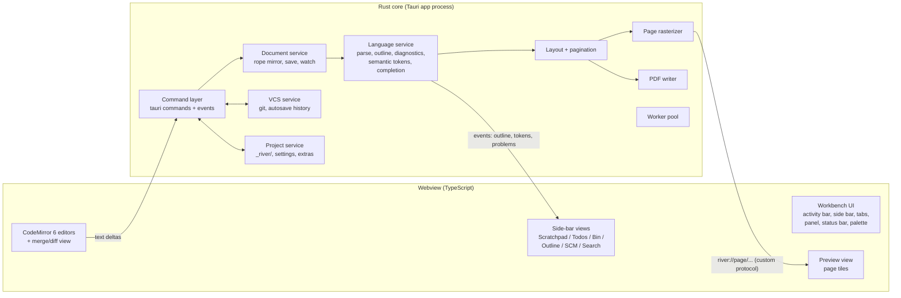
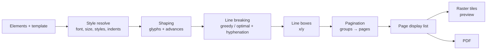

# 05 — Architecture (Tauri)

Status: design, no code yet. Library names are **recommendations to verify at build
time** (maturity, licenses, current versions). Behaviour references point to
`~/rea/HIGHLAND_SPEC.md` (§ numbers).

---

## 1. Goals and constraints

| Goal | Consequence |
|---|---|
| **Preview = print**, exactly | One layout engine in Rust produces page geometry; both preview and PDF draw from it. The webview never lays out page text itself. |
| Plain files are the source of truth | `.fountain`/`.md` on disk; all derived data (parse trees, pages) is cache. |
| Offline; network only on push/pull/fetch/clone | No HTTP plugin, no updater, no telemetry; git networking lives in Rust and runs only on explicit commands. |
| Feels exactly like VS Code | VS Code-faithful workbench (doc 03) + CodeMirror 6 editor with a VS Code keymap/theme. |
| Fast on long scripts and novels | Incremental parse and pagination; background work off the UI thread. |
| Small, native-feeling app | **Tauri 2** (system webview), Rust core — **locked** (decision #31). |

Performance budgets (targets on an M-series Mac / mid-range PC):

| Interaction | Budget |
|---|---|
| Keystroke → editor highlight | < 16 ms (client-side tokenizer) |
| Keystroke → outline/diagnostics refresh | < 100 ms (debounced 50 ms) |
| Pagination runs | **only while the preview is open, or on export/print** (the editor never needs page data) |
| Edit → preview pages updated, 120-page script | < 150 ms after debounce |
| Edit → preview updated, 400-page novel | < 300 ms after debounce |
| Open project (400-page novel) | < 1 s to first editable view |
| Export PDF, 120 pages | < 1 s |
| Commit | < 300 ms |

---

## 2. Process model



* **One Tauri app process** hosts the Rust core; one window per project
  (VS Code style: "New Window", "Open Recent").
* **Heavy work** (pagination, rasterizing, diff, git) runs on a worker pool (`rayon`
  for CPU-bound work, plus a small async runtime from Tauri's `tokio` for I/O). The
  command layer never blocks the main thread.
* **The webview owns interaction; Rust owns truth and computation.** The webview never
  parses Fountain for anything beyond fast highlighting, and never paginates.

---

## 3. Repository layout

```
river-writer/
├── docs/                         product docs (this folder)
├── crates/                       Rust workspace (UI-independent, unit-testable)
│   ├── river-model/              Element, ElementType, Token, Script, TitlePage, ranges
│   ├── river-parse/              Fountain + Markdown(-subset) parsers, incremental
│   ├── river-templates/          Template data (Screenplay, Multi-cam, Stage Play, Manuscript)
│   ├── river-text/               fonts, shaping, line breaking, hyphenation, sentence segmentation
│   ├── river-layout/             element → line boxes (measure, wrap, styles)        
│   ├── river-paginate/           grouper + paginator (MORE/CONT'D, splits, keep-together)
│   ├── river-render/             page display list → raster tiles (preview)
│   ├── river-pdf/                page display list → PDF (font subsetting, metadata, outline)
│   ├── river-fdx/                Final Draft import/export
│   ├── river-diff/               structural/paragraph/word diff, 3-way scene merge
│   ├── river-vcs/                git (repo, commit, branch, remote), autosave history
│   ├── river-project/            project folder, _river/, river.json, settings, extras, watcher
│   └── river-service/            orchestration: DocumentStore, LanguageService, PreviewService
├── app/
│   ├── src-tauri/                Tauri shell: commands, events, protocols, capabilities, menus
│   └── ui/                       TypeScript workbench + CodeMirror 6 integration
├── fonts/                        bundled fonts (+ license files)
└── fixtures/                     golden test corpus (scripts, novels, expected pages/PDF renders)
```

Rule: **nothing in `crates/` depends on Tauri.** The same crates power a CLI
(`river export script.fountain --template screenplay -o out.pdf`), which doubles as the
test harness and a scripting interface.

---

## 4. Data model (river-model)

```rust
enum ElementType {            // order mirrors Highland's for spec cross-reference (§3)
  Action, SceneHeader, Transition, Centered, SectionHeader, Synopsis,
  PageBreak, ParagraphBreak, Lyric, CharacterCue, Dialogue, Parenthetical,
  DualDialogueCue, Boneyard, LineBreak, Blockquote, OrderedListItem,
  UnorderedListItem, HorizontalRule, Directive, TermList, ForcedRight,
  ForcedLeft, Toc, Note, /* … only what River's 4 templates need */
}

struct Element {
  kind: ElementType,
  src: Range<usize>,          // byte range in source (for sync scrolling, diff, jump)
  text: SmolStr,              // display text with forcing chars stripped
  inline: Vec<InlineSpan>,    // bold/italic/underline/highlight/strike/note ranges
  level: u8,                  // section depth
  scene_number: Option<SmolStr>,
  dual: Option<DualSide>,
}

struct Script { title_page: TitlePage, elements: Vec<Element>, scenes: Vec<SceneIndex> }
```

* Elements carry **source ranges** everywhere: they drive preview↔editor sync,
  click-to-jump, diff anchoring and outline navigation.
* `SceneIndex` = (heading element, element range, stable scene id) for the outline,
  structural diff and scene merge.

---

## 5. Parsing (river-parse)

* **Fountain parser** implements the rules from spec §4:
  * paragraph classifier order (14 rules, §4.1), `isSceneHeader` (forced `.`, terms),
    `isTransition` (`>` or suffix terms), `isCharacterCue` (no lowercase before `(`/`^`,
    preceded by a blank line, followed by a non-blank line) and `@` forcing;
  * the dialogue state machine (§4.2): cue → parenthetical/dialogue/lyric/`!` action
    until a blank line; `^` dual dialogue;
  * notes `[[ ]]`, boneyard `/* */`, synopses `=`, sections `#`, page breaks `===`,
    centered `> <`, lyrics `~`, scene numbers `#n#`, title page key/values,
    `{{INCLUDE}}` (project-relative, cycle-safe).
* **Markdown-subset parser** for Manuscript: headings (chapters/sections), paragraphs,
  emphasis, blockquotes, lists, horizontal rules (scene breaks), notes/boneyard/synopses
  shared with Fountain. Use a CommonMark parser (e.g. `pulldown-cmark` or `comrak`)
  restricted by a whitelist, plus River's extensions.
* **Inline markup** (emphasis/underline/highlight/strike/notes) is parsed into
  `InlineSpan`s with escapes honoured (`\*`, `\>`).
* **Incremental parsing:** the document is split into **paragraph blocks** (separated
  by blank lines). An edit re-parses only the affected blocks, plus a small context
  window: the previous block (cue detection needs the preceding blank line), and dialogue
  continuation up to the next blank line. Block results are cached by content hash, so
  undo/redo and branch switches hit the cache.
* Output: `Script` + **semantic tokens**, **outline**, **diagnostics** (§11) and
  **character index**.

---

## 6. Templates (river-templates)

Templates are **data**, not code. Each has a typed struct (serde-serializable) with
values taken from the spec (§5 H2, §10.2 Pro):

```rust
struct Template {
  id: TemplateId,                     // manuscript | screenplay | screenplay_multicam | stageplay
  body_font: FontChain, size_pt: f32, // always ["Courier Prime"] 12 (decision #35)
  margins_pt: Insets,                 // 72/72/72/72 (Manuscript: from spec)
  line_height: f32,                   // 1.0 screenplay; 2.36-style double for manuscript
  dialogue_line_height: f32,          // 2.0 multi-cam
  element_left: EnumMap<ElementType, Option<f32>>,  // fraction of page width
  element_width: EnumMap<ElementType, Option<f32>>,
  default_left: f32, default_width: f32,
  element_styles: EnumMap<ElementType, Styles>,     // bold=2 italic=4 underline=8 upper=16
  section: SectionStyle,              // per level: font, size, style, align, padding, line height
  header: HeaderSpec, footer: HeaderSpec,           // "%p." right-aligned etc.
  cheat_page_break_pt: f32,           // 24 screenplay, 60 stage/multi-cam
  break_at_sentences: bool, merge_parentheticals: bool,
  first_line_indent_pt: f32, print_scene_headers: bool, print_sections: bool,
}
```

* Geometry is expressed as **fractions of page width** (Highland's model), so A4 and
  Letter both work; the offset-margins model (§10.2) is applied when resolving x positions.
* User-adjustable options (bold/underlined scene headings, double-spaced headings)
  are **settings overlays** merged onto the base template.
* Template choice per file: `river.json` map → extension default (`.md` Manuscript,
  `.fountain` Screenplay) (doc 02, decision #21).

---

## 7. Typesetting — the core of "lead with craft"

Highland relies on Apple's TextKit. River owns this pipeline end to end:



### 7.1 Fonts (river-text)
* **One bundled font (decision #35):** Courier Prime (Regular/Italic/Bold/BoldItalic),
  SIL OFL, 12 pt, for every template and the editor. No font settings.
* Font loading and metrics: `ttf-parser` / `skrifa`. Glyph outlines for raster: `swash`
  or `skrifa` + a scaler.
* Fallback for missing glyphs (e.g. CJK names in a script): a bundled fallback font, or
  system fonts *for glyph fallback only*, flagged in Problems ("Page uses system font for
  3 characters").

### 7.2 Shaping and segmentation
* Shaping: `rustybuzz` (HarfBuzz port) for kerning, ligatures and complex scripts.
* Segmentation (`unicode-segmentation`): graphemes (cursor/ranges), **words** (word
  counts, word diff), **sentences** (UAX #29) for sentence-boundary page breaks (spec §7).
* Line-break opportunities: `unicode-linebreak` (UAX #14).

Alternative to assembling these pieces: a higher-level layout crate (`cosmic-text` or
`parley`) for shaping + line layout. **Recommendation:** start with `parley` or
`cosmic-text` if one gives precise control of line widths, per-run styles and glyph
positions; otherwise compose `rustybuzz` + custom breaking. Decide with a spike (§16, phase 0).

### 7.3 Line layout (river-layout)
* Input: an element + resolved style → output `Vec<LineBox>` (glyph runs with x
  offsets, baseline, height).
* **Monospace path (all templates):** Courier Prime at 12 pt = 7.2 pt per character
  (10 cpi), so wrapping is column arithmetic (e.g. action ≈ 61 columns, dialogue ≈ 35).
  Exact and very fast; still validated against Parley's line breaking in tests.
* **Manuscript:** ragged-right, greedy breaking, no justification or hyphenation;
  first-line indent (none on a continuation after a page split, spec §7); the first
  line of a chapter is uppercased (`capitalizeFirstNewParagraphLine`; no small caps).
* Element styles (template bit flags, spec §5): bold/italic/underline/uppercase applied
  before shaping (uppercase transforms the text; underline is a decoration in the display list).
* Width rules: `x = margin_left + left_fraction × page_width`,
  `width = width_fraction × page_width`, clamped to the right margin.
* **Measurement cache:** line boxes keyed by (element text hash, style hash, width);
  most edits re-layout one paragraph.

### 7.4 Pagination (river-paginate)
Implements spec §6–§7 as a pure function over cached line boxes:
1. **Grouper:** printability filter (scene/section headers per template, synopses/notes
   per print options), blank-line compression, keep-together groups (scene heading +
   first block; cue + parenthetical + first dialogue lines; dual dialogue as one
   unit), isolated groups for page breaks.
2. **Paginator:** fill `space_left_on_page`; when a group doesn't fit:
   * allow overflow up to `cheat_page_break_pt` (24 pt screenplay, 60 pt stage/multi-cam);
   * **dialogue split**: keep at least N lines (rule: ≥ 2 lines on each side), break at
     a sentence boundary if the template says so, add `(MORE)` (parenthetical position)
     and repeat `CUE (CONT'D)` at the top of the next page (the strings are settings);
   * **action/prose split**: break at a sentence boundary (screenplay family) or line
     boundary (manuscript); widow/orphan control (≥ 2 lines); the continuation gets no
     first-line indent;
   * scene headings and character cues never end a page (keep-with-next).
3. **Headers/footers:** `%p`, `%pp`, `%title`, `%#`, `%none`, alignment and styles per
   template; first-page suppression rules.
4. **Title page** as page 0 (centered title block, bottom-left contact, bottom-right
   draft date), excluded from numbering.
* **Incremental pagination:** pages are a chain; after an edit, re-paginate from the
  first page whose input groups changed, and **stop when a page's start state matches the
  cached chain** (same group index and offset). Typical edits re-flow 1–3 pages.
* Output: `Vec<Page>`, each a **display list**.

### 7.5 Display list (shared by preview and PDF)
```rust
enum DrawOp {
  GlyphRun { font: FontId, size: f32, origin: Pt, glyphs: Vec<(GlyphId, f32 /*x*/)>,
             color: Rgba, src: Range<usize> },
  Rule { from: Pt, to: Pt, width: f32 },              // underline/strike/hr
  Rect { rect: RectPt, fill: Rgba },                  // highlight, revision tint
  Image { rect: RectPt, asset: AssetId },
  Mark { kind: MarkKind, at: Pt },                    // revision asterisk, scene number
  Link { rect: RectPt, target: LinkTarget },          // PDF outline/links
}
struct Page { number: Option<String>, size: SizePt, ops: Vec<DrawOp>, src: Range<usize> }
```
`src` ranges let the preview map clicks to text and sync scrolling both ways.

### 7.6 Preview rendering (river-render)
* **Rust rasterizes pages** from the display list at the device pixel ratio
  (e.g. `tiny-skia` for paths/rects + glyph outlines from the font scaler), producing
  **exact** pixels. No webview text layout.
* Delivered through a **Tauri custom URI scheme** (`river://page/<doc>/<rev>/<n>@<scale>.webp`):
  the preview view is a virtualized list of `` tiles; only visible ±2 pages render.
  Zooming re-requests at the new scale (blurry-then-sharp swap).
* Cache by (page content hash, scale). Unchanged pages after an edit are never re-rendered.
* Theme: pages stay white paper in both themes (decision #19); the surrounding canvas follows the theme.
* Alternative considered: render PDF and show via pdf.js. Rejected for latency and
  incremental updates; still possible as a fallback.

### 7.7 PDF (river-pdf)
* Writer: `krilla` (high-level, handles font embedding/subsetting) or `pdf-writer` +
  `subsetter` (lower-level). Both come from the Typst ecosystem.
* Features: subset-embedded fonts, real text (selectable/searchable), document outline
  (scenes/chapters as bookmarks), metadata (title/author from the title page), optional
  PDF/A for archiving, revision asterisks/colors (v1.1), reader-copy options (line
  numbers, margin notes) (v1.1).
* Same display list as the preview, so print matches preview by construction.

---

## 8. Editor integration (webview)

### 8.1 CodeMirror 6 (decision #27)
Packages are the official `@codemirror/*` modules unless noted; community packages are
**to be verified** (maintenance, license) before adoption.

* **Language support** for `fountain` and `river-markdown`:
  * a fast client-side highlighter for instant feedback: a Lezer grammar or a
    `StreamLanguage` tokenizer approximating the Rust parser (scene headings, cues,
    parentheticals, transitions, notes, boneyard, emphasis);
  * **authoritative element classification from Rust** after each parse (e.g. whether an
    uppercase line really is a cue), applied as decorations and overriding the
    client-side guess;
  * folding (`foldService`) for sections/scenes; outline and breadcrumbs from Rust;
  * autocomplete (`@codemirror/autocomplete`): character names, scene-heading prefixes,
    locations, times of day (from the project index);
  * diagnostics (`@codemirror/lint`) → inline markers + the Problems panel;
  * rename character (F2) as a River command, executed in Rust across project files.
* **Script look (Screenplay / Multi-cam / Stage Play):** a `ViewPlugin` maps each line's
  element type (from Rust, with the client-side guess as interim) to a **line
  decoration** (`Decoration.line({class})`). CSS custom properties per template set
  `padding-left`, `max-width` (in `ch`, editor font Courier Prime) and `text-align`, e.g.
  `.cm-el-dialogue { padding-left: 10ch; max-width: 45ch }`. **Mark decorations** dim
  forcing characters and render emphasis; the document text is never modified.
  Values derive from the active template (`element_left`/`element_width` × 8.5″ × 10 ch/in),
  so the editor and the PDF share one geometry source.
* **Manuscript:** no structural indents; a centered ~72 ch column, Courier Prime,
  heading line decorations (larger/bold), emphasis marks with dimmed markers.
* **VS Code parity:** VS Code keymap (community keymap package or our own keymap
  table), search panel themed like VS Code's find widget (`@codemirror/search`),
  multiple cursors (built in), bracket/quote auto-close, minimap via **`@replit/codemirror-minimap`** (MIT, Replit;
  decision #28 — verify maintenance at adoption), themes generated from the Light/Dark Modern palettes.
* Editor behaviours: auto-uppercase cues and scene headings as you type, Tab to cycle
  element type (optional, Final Draft habit), typewriter scrolling in Zen mode.
* **Writing surface, not page:** no line-number gutter; a slim gutter only for change
  bars and folding; no page markers, headers, footers or page numbers. One font:
  Courier Prime (decision #35).

### 8.2 Text synchronization (webview ↔ Rust)
* **CodeMirror holds the live buffer** for responsiveness. Each transaction's `ChangeSet`
  is sent to Rust as a compact delta `{doc_id, version, changes:[{from, to, insert}]}`
  (batched per animation frame).
* Rust keeps a **rope mirror** (`ropey`) per open document, applies deltas, verifies
  `version`, and re-syncs with a full-text resend on mismatch.
* Language results come back tagged with the version they were computed for; stale
  results are dropped.
* **Saving:** Rust writes atomically (temp file + `fsync` + rename) from its mirror.
  Autosave to disk after 1 s idle (setting); the dirty dot follows VS Code semantics.
* **External changes** (another editor, git checkout, sync folder): `notify` watcher →
  if clean, reload silently; if dirty, VS Code-style "file changed on disk" compare/choose.

### 8.3 Workbench UI
* TypeScript + **SolidJS** (decided, §19.3),
  styled with VS Code's CSS variables (`--vscode-*` equivalents) so both themes map
  1:1 to the Light/Dark Modern palettes.
* **Codicons** for icons. Core components: activity bar, side bar container, tabs
  and editor groups (split/drag), panel, status bar, quick input (palette/quick open),
  context menus, notifications, settings editor, keybindings resolver.
* **Command registry** (TS) mirrors VS Code: every action is a command id
  (`river.exportPdf`, `river.git.commit`…) with title, keybinding, `when` clause; menus
  and the palette are generated from it. Rust exposes the operations; TS owns UI commands.
* **Keybindings:** VS Code default keymap; user overrides in `keybindings.json`.

---

## 9. IPC contract (Tauri 2)

* **Commands** (request/response, `#[tauri::command]`, typed with `serde`; TS types
  generated via `specta`/`tauri-specta` to keep both sides in sync):
  * project: `open_project`, `list_files`, `create_file`, `rename_file`, `delete_file`
  * document: `open_document`, `apply_changes`, `save`, `close_document`
  * language: `outline`, `semantic_tokens`, `completions`, `rename_character`, `search_project`
  * preview: `paginate` (returns page count, page src ranges, revision id), `page_at_offset`, `offset_at_point`
  * export: `export_pdf`, `export_fdx`, `import_fdx`, `print`
  * extras: `scratchpad_get/set`, `todos_get/set`, `bin_list/add/remove/get`
  * vcs: `status`, `commit`, `log`, `diff`, `branches`, `checkout`, `create_branch`, `merge_preview`, `merge_apply`, `tag`, `revert`, `restore`, `remotes`, `push`, `pull`, `fetch`, `clone`, `local_history`, `restore_local`
  * settings: `get_settings`, `update_settings`
* **Events** (Rust → UI, `emit`): `document:parsed`, `preview:pagesChanged` (changed page
  indices + new revision), `problems:updated`, `vcs:statusChanged`, `fs:externalChange`,
  `task:progress` (push/pull/export).
* **Channels** (Tauri 2 `Channel`) for streaming long operations (clone progress, PDF export progress).
* **Custom protocol** `river://` for page tiles and project assets (images).

---

## 10. Project, files and extras (river-project)

* Project = folder (doc 02). On open, River reads `_river/river.json` (UI state +
  per-file templates), `_river/settings.json` (project settings) and the extras.
* **Extras** are served to the side-bar views through commands; files are written
  atomically on change (debounced 500 ms):
  * Scratchpad → `_river/scratchpad.md` (whole-text set)
  * Todos → `_river/todos.md` (parsed as `- [ ]` lines; preserves unknown lines verbatim)
  * Bin → `_river/bin/<YYYY-MM-DD HHMM> <first words>.<ext>` (one file per snippet)
* The Explorer view excludes `_river/` and `.git/` (like `files.exclude`).
* Lone-file mode: the sidecar is created only when an extra is first used (decision #8).
* **Settings** resolution: defaults → user (`<app config dir>/settings.json`) → project
  (`_river/settings.json`), with a JSON Schema driving the settings editor and validation.

---

## 11. Diagnostics ("script check")

Computed in the language service after each parse (cheap, incremental):
* the same character cue spelled several ways (edit distance / case: `JON` vs `JOHN`)
* unclosed `[[note` or `/* boneyard`
* empty scene (heading followed by heading)
* `{{INCLUDE}}` target missing or cyclic
* dual-dialogue `^` without a preceding cue
* page-layout warnings from pagination (unbreakable element taller than a page, system font fallback)
No grammar or spelling beyond the system spellchecker in the editor.

---

## 12. Version control (river-vcs)

### 12.1 Library
* **`git2`** (libgit2 bindings) for v1: mature commit/branch/merge-base/diff, and
  **remote operations over SSH and HTTPS** with credential callbacks.
* Evaluate **`gix`** (gitoxide, pure Rust) for read-heavy paths (status, log, diff),
  where it's fast. Adopt it fully once its push support is mature.
* No dependency on a system `git` binary.

### 12.2 Repository conventions
* Standard repository at the project root; adopt an existing one.
* `.gitignore` managed section: `_river/river.json`, plus any user "Ignore" choices.
* **No staging UI:** `commit` = add-all (respecting ignores) + commit. Author identity:
  git config if present, else first-run prompt (name/email), stored in git config.
* Branch switch with uncommitted changes: offer "Commit first" or "Carry changes over".
  Carry over is a checkout with merge; on a conflict, fall back to an internal stash
  that is never shown to the user.

### 12.3 Autosave history (local only)
* **Decided (§19.4):** stored in a separate repository at `.git/river-autosave/` that
  shares objects with the main repository via `objects/info/alternates` (no duplication),
  one autosave branch per real branch. *(Earlier plan: private refs
  `refs/river/autosave/<branch>` in the main repository; replaced to remove any
  `--mirror` leak risk.)*
* Created after ~90 s of idle when content changed; message `autosave`.
* **Never pushed:** it isn't part of the main repository's refs, so no push (including
  `git push --mirror` from the CLI) can include it; a fresh clone has commits but no autosaves.
* **Retention:** a compaction job rewrites the autosave chain to keep all of today,
  hourly for 7 days, daily for 30 days, weekly beyond. Unreferenced objects are
  collected by periodic `gc`.
* Surfaced in the **Timeline** view merged with real commits, per file.

### 12.4 Diff (river-diff)
* Text diff engine: `imara-diff` or `similar` (Histogram/Myers).
* **Three levels**, computed from parsed structures:
  1. **Structural:** match scenes between versions by stable id → heading text →
     content similarity (Jaccard on word shingles); classify added/removed/moved/edited.
  2. **Paragraph:** within matched scenes, align blocks.
  3. **Word:** within changed blocks, word-level diff using word segmentation.
* Output drives the CodeMirror merge view (`@codemirror/merge`: side-by-side and unified), with custom decorations for word changes and scene
  badges) and the **page diff** (v1.1: changed pages flagged by comparing display-list
  hashes plus mapped source ranges).

### 12.5 Merge (scene-level, v1.1)
* 3-way: merge base (`git merge-base`), ours, theirs → parse all three → align scenes
  (as in structural diff) → for each scene: unchanged / one-sided change (auto-take) /
  both changed (conflict). Inside a conflicted scene, offer a block-level 3-way merge
  first; if still overlapping, present ours/theirs/both/edit.
* Non-scene content (title page, front matter) is treated as one pseudo-scene.
* Result is written as normal file content and committed as a real merge commit (two
  parents), so GitHub and other tools see standard history.
* Cherry-pick scene/paragraph: a text patch applied to the current buffer (not a git
  cherry-pick commit), recorded in the next commit message.

### 12.6 Remotes and credentials
* Push/pull/fetch/clone run **only on explicit user action**, with progress over a channel.
* Credentials: SSH agent/keys (`~/.ssh`), the OS credential manager
  (macOS Keychain / Windows Credential Manager / libsecret), and git's credential helper
  config. Never stored by River in plain files.
* Pull = fetch + (fast-forward or scene merge). No rebase.
* Optional v1.1 "Sign in with GitHub" via OAuth device flow, token stored in the OS keychain.

### 12.7 Revision marks (v1.1)
* Pick a tag (e.g. `shooting-script`) → word diff from the tag to the working text →
  paginator emits revision asterisks in the right margin for changed lines, plus optional
  page color names (Blue, Pink, Yellow…) in headers. Page locking (A-pages) is a later
  feature, if ever.

---

## 13. FDX (river-fdx)
* XML via `quick-xml`. Map Final Draft paragraph types ↔ River elements (Scene Heading,
  Action, Character, Dialogue, Parenthetical, Transition, Shot→Action, General→Action,
  Lyrics, Cast List→Action). Styles (bold/italic/underline) ↔ inline spans; dual dialogue
  ↔ `DualDialogue` blocks; title page ↔ `TitlePage` content; scene numbers.
* Import produces `.fountain`; export writes FDX 5-compatible XML. Round-trip tests.

---

## 14. Security, privacy and the network promise

* **Tauri 2 capabilities:** a minimal permission set. Filesystem access is limited to
  the opened project directories (granted via the open dialog) and the app config/data
  dirs. No shell plugin, no HTTP plugin, no updater plugin, no opener for arbitrary URLs.
* **Strict CSP** in the webview: no remote scripts/styles/images; `river://` and
  `asset:` only. Markdown/Fountain content never executes HTML (HTML elements are escaped).
* **Network:** the only code paths that open sockets are git remote operations
  (libgit2 transports), invoked from push/pull/fetch/clone commands. A CI test asserts
  that no other networking crates are linked (dependency audit) and that the app makes
  no connections at startup or while idle.
* No telemetry, no crash upload. Crash logs are written locally (opt-in "Reveal log").
* Updates: **manual only** (decision #30). "Check for Updates…" and "Subscribe to
  Updates…" open the website in the default browser; River itself never connects. See doc 08.

---

## 15. Testing strategy

| Layer | Approach |
|---|---|
| Parser | Fountain spec examples + River rules corpus (from HIGHLAND_SPEC §4); snapshot tests of element streams; fuzzing (`cargo-fuzz`) for panics and incremental-vs-full-parse equivalence |
| Templates | Value tests against the spec tables |
| Layout | Line-break snapshots; screenplay fast path vs general path equivalence |
| Pagination | **Golden pages**: fixture scripts → expected page breaks (page N starts at source offset X), MORE/CONT'D placement, sentence splits; property tests (no content lost or duplicated, every group placed) |
| Render/PDF | Visual regression: render pages → PNG → perceptual diff against approved images; PDF text extraction round-trip |
| Diff/merge | Synthetic edit scripts (move/edit/insert scenes) → expected structural classification; 3-way merge cases |
| VCS | Temp repos: commit/branch/merge/autosave-never-pushed (inspect the refspecs actually pushed to a local bare remote) |
| UI | Playwright-style end-to-end against the Tauri app (WebDriver), keybinding and command coverage |
| Performance | Benchmarks (`criterion`) for parse/paginate/render on 120-page and 400-page fixtures, gated in CI against the budgets in §1 |

Fixtures: hand-written public-domain scripts and prose. **Do not** use Highland's
sample documents.

---

## 16. Build phases

| Phase | Deliverable | Exit criteria |
|---|---|---|
| **0. Spikes** (1–2 wks) | Typesetting spike with **Parley + krilla**: Courier Prime screenplay + manuscript page → PDF + raster from one display list. Editor spike: CodeMirror 6 script look (line decorations from template geometry) + VS Code keymap | Preview pixels = PDF render; 120 pages < 150 ms incremental |
| **1. Engine CLI** | `river-parse`, `-templates`, `-layout`, `-paginate`, `-pdf`, CLI export | Golden pagination tests pass for all 4 templates |
| **2. Shell** | Tauri app, workbench skeleton (activity bar, Explorer, tabs, status bar, palette), CodeMirror 6 + Fountain/Markdown support + script look, document sync, save/watch | Edit + save + reopen; highlighting; outline |
| **3. Preview** | Tile renderer, custom protocol, sync scroll, template dropdown + preview icon | Live preview within budget |
| **4. Extras & settings** | Scratchpad/Todos/Bin views, settings editor, keybindings, Light/Dark themes, Zen mode | Feature-complete UI for v1 |
| **5. VCS** | Commit/log/diff/branch/checkout/restore, autosave history + Timeline, remotes push/pull/fetch/clone | Never-push-autosave test passes; credentials work for SSH + HTTPS |
| **6. FDX + polish** | FDX import/export, Problems panel basics, packaging, signing/notarization | v1 release candidate |
| **v1.1** | Scene merge, cherry-pick, revision marks, page diff, rename character, Characters/Stats views, reader copy, GitHub sign-in | — |

---

## 17. Packaging and platforms

* macOS: universal binary, hardened runtime, notarized; `.dmg`; file associations for
  `.fountain` (and optionally `.md`, without claiming ownership).
* Windows: MSI/NSIS installer, WebView2 runtime (evergreen; bootstrapper included),
  Authenticode code-signed; file association for `.fountain`.
* Linux: **not in scope** (later or never; community port welcome). If added: AppImage +
  `.deb`, WebKitGTK minimum version, `.desktop` file and MIME type for `.fountain`.
* Bundled fonts ship with their license files (OFL text) in the app and the About panel.
* **Decided (#29, revised): macOS and Windows at v1**, same features and behaviour on both.
  Linux later or never (community port welcome, since River is open source).
  * **CI matrix:** build, unit tests, golden pagination, visual-regression renders and
    E2E smoke tests on macOS and Windows for every change. A feature isn't done until it
    passes on both.
  * **Rendering parity:** pages are rasterized in Rust from bundled fonts, so preview and PDF
    are identical across OSes by construction. Only the workbench UI depends on the webview
    (WKWebView on macOS, WebView2/Chromium on Windows; both mature).
  * **Per-OS integration points**, each behind one Rust abstraction: credential store
    (Keychain / Credential Manager), printing (native print dialog with the generated PDF),
    file associations, menus (macOS app menu vs in-window menu bar on Windows, mirroring
    VS Code), keybindings (`⌘` ↔ `Ctrl` mapping as in VS Code), window chrome (VS Code-style
    custom title bar on Windows, native traffic lights on macOS).
  * **Spellcheck:** system spellcheck via the webview on both (good on macOS and Windows).
* **Paths and line endings:** the project uses `/`-normalized relative paths in
    `river.json`; text is saved with the line endings it was opened with (default LF for
    new files); git `core.autocrlf` is left to the user's config.

---

## 18. Risks and mitigations

| Risk | Mitigation |
|---|---|
| Typesetting quality (glyph positions, wrapping parity) | Phase-0 spike; one monospace font; golden visual tests |
| Webview differences (WKWebView vs WebView2) affecting the editor/UI | CodeMirror 6 is cross-browser tested; keep UI CSS conservative; E2E tests per OS |
| libgit2 credential edge cases (SSH agents, 2FA tokens) | Lean on OS keychains + credential helpers; clear error messages; device-flow sign-in in v1.1 |
| Autosave store corrupted/deleted | It's a disposable safety net in `.git/river-autosave/`; real history is unaffected |
| Large projects (multi-file novels with 100+ chapters) | Per-file parse caches, project-level indices built lazily, pagination only for the previewed file / includes |
| Scope creep toward "VS Code features" | Doc 01 principles; "Never" list in doc 06; no extension host |
| CodeMirror falls short of VS Code polish (find widget, minimap, keymap details) | Theme/keymap work budgeted in phase 2; community add-ons verified or replaced by small in-house modules |

---

## 19. Technical decisions (resolved 2026-10-17)
1. **Text layout: Parley** for shaping and line layout, with River's own pagination. No
   justification (decision #35: one monospace font, ragged-right). The phase-0
   spike must confirm identical glyph positions for raster and PDF; cosmic-text/custom
   are the fallbacks.
2. **PDF: krilla** (font subsetting, outlines, links, metadata, PDF/A); drop to
   `pdf-writer` for any single feature krilla lacks.
3. **Workbench UI: SolidJS** (fine-grained updates for many small VS Code-style widgets;
   JSX keeps a React switch cheap). React is the fallback if developer familiarity wins.
4. **Autosave store: a separate repository inside `.git/` (`.git/river-autosave/`)**
   sharing object storage with the main repository via git alternates. Never part of
   any push (even `--mirror`), invisible to other git tools, moves with the project,
   self-contained pruning. Lone-file mode: app data dir keyed by file path. Supersedes
   the private-refs plan in §12.3.
5. **Platforms: macOS and Windows at v1; Linux later or never** (decision #29, revised).
6. **Shell: Tauri 2, locked** (decision #31) after comparing with Electron (maturity, identical
   engine, Linux) — River's focused scope, Rust-native core and strict network promise favour Tauri.
