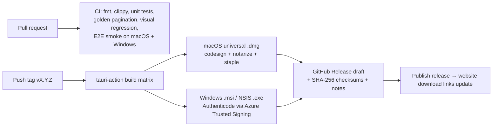

# 08 — Release, distribution and updates

Goal: **releasing should take no thought.** Bump the version, push a tag, and CI builds,
signs and publishes. Users update manually; River itself never contacts a server for
updates.

## Update policy (decision #30)
* **No auto-update and no update checks.** River makes **no network connections except
  git push/pull/fetch/clone** (the network promise stays strict).
* **Help → Check for Updates…** opens the River website's download page **in the default
  browser** (the browser connects, not River).
* **Help → Subscribe to Updates…** opens the newsletter sign-up page in the browser.
  Email addresses are collected **on the website only**, never in the app.
* **Help → About River** shows the installed version and build.
* Release notes: newsletter, website changelog, GitHub Releases.
* **Updating:** download the new installer and install over the old version. Settings
  (app config dir) and projects (plain folders) are unaffected. Settings and project
  formats stay backward-compatible; a newer River never silently rewrites `_river/` in a
  way an older River can't read (version field in `river.json`, additive changes only).

## Keeping the door open for a future updater (decision #34)
v1 has **no updater, no update checks, and no package-manager channels** (no Homebrew,
no winget). Nothing in v1 may make adding an **opt-in** updater later expensive:

| Keep stable from v1 | Why it matters later |
|---|---|
| **App identity**: macOS bundle identifier, Windows product name + **UpgradeCode** (MSI) / NSIS app id | An updater (or a newer installer) can only replace an install it recognises |
| **Signing identities**: same Apple Developer ID team and Windows signing publisher on every release | Updates must be signed by the same identity, or the OS treats the app as different/untrusted |
| **Install locations** (`/Applications/River Writer.app`, per-user/per-machine choice on Windows decided once) | The updater swaps files in place |
| **Semantic versioning** on every release | The updater compares versions |
| **GitHub Releases as the canonical artifact host**, with stable asset naming | A future `latest.json` manifest can point at the same assets |
| **Backward-compatible settings and `_river/` formats** (additive changes, version field) | Updating must never break existing projects |

Prepared but **not shipped** in v1:
* An **updater signing keypair** (Tauri updater, Ed25519) generated once and stored
  offline (hardware-backed or password-protected, never in CI), so the first
  updater-capable release can be signed without a scramble.
* The release workflow has `createUpdaterArtifacts` **off**; turning it on later produces
  signed update bundles from the same pipeline.
* Settings schema reserves `update.mode` (only `"off"` in v1).
* The network-promise audit (dependency check + no-connection test) is written as an
  **allow-list** (today: git only), so adding the updater later is one reviewed line,
  not a rewrite.

If an updater is ever added, it must follow the guards already agreed: **opt-in** (asked
once, default off), signed (Ed25519 + OS code signing), HTTPS to one fixed static URL, no
identifiers sent, never silent installs, never during unsaved work, and the network
promise is publicly reworded at that time.

## CI/CD pipeline (GitHub Actions)

### On every pull request / push to `main`
* Rust: `cargo fmt --check`, `cargo clippy -D warnings`, unit + golden tests
  (pagination, parser corpus), `cargo deny`/audit (licenses, advisories, and the
  **no-networking-crates check** for the network promise).
* UI: typecheck, lint, unit tests.
* Visual regression renders (pages → PNG → perceptual diff).
* E2E smoke tests of the built app on **macOS and Windows** runners.
* Performance benchmarks against the budgets in doc 05 §1 (fail on regression).

### On a version tag (`vX.Y.Z`)
* **`tauri-apps/tauri-action`** builds the installers in a matrix:
  * **macOS:** universal binary (Apple Silicon + Intel) `.dmg`; **codesign with a
    Developer ID certificate, notarize, staple** (Apple credentials as GitHub secrets).
  * **Windows:** `.msi` and/or NSIS `.exe`; **Authenticode signing via Azure Trusted
    Signing** (or an OV certificate); WebView2 bootstrapper included.
  * **Linux:** not built (later or never; community port welcome).
* Creates a **draft GitHub Release** with the installers, SHA-256 checksums and release notes
  generated from the changelog.
* Publishing the release is the only manual click. The website's download links point to
  the latest GitHub Release assets (or are updated by a small website deploy step).
* No updater manifest is generated (no auto-update).

### Release flow (the whole thing)
1. Update `CHANGELOG.md`.
2. `git tag vX.Y.Z && git push --tags`.
3. Wait for CI, review the draft release, click **Publish**.
4. Send the newsletter.

## One-time setup (the only real chores)
| Item | Why | Cost (approx.) |
|---|---|---|
| Apple Developer Program | Developer ID signing + notarization so macOS doesn't block the app | $99/year |
| Windows code signing (Azure Trusted Signing, or an OV certificate) | Avoid "unknown publisher" / SmartScreen warnings | ~$10/month (Azure) |
| GitHub repository secrets | Apple ID/app-specific password or API key, team ID, certificates; Azure signing credentials | — |
| Website + newsletter service | Download page, changelog, sign-up (any static site + a newsletter provider) | provider-dependent |

## Versioning
* **Semantic versioning:** `MAJOR.MINOR.PATCH`. Patch = fixes; minor = features (slow,
  deliberate); major = rare, only for unavoidable format changes (with migration).
* `CHANGELOG.md` in the repository is the source for release notes and the newsletter.

## Not doing
* Auto-update, update checks, in-app newsletter sign-up, telemetry, crash upload.
* App stores for v1 (Mac App Store sandboxing complicates git over SSH and project
  folder access). Possible later as an extra channel.
